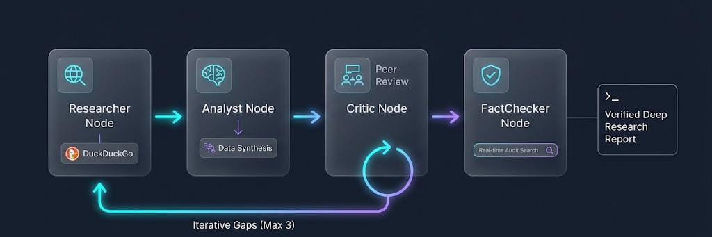

# Deepify

An iterative, multi-agent deep research pipeline with real-time DuckDuckGo web grounding and automated fact-checking, built on **LangGraph**.

---

## Architecture & Workflow

<!-- PASTE ARCHITECTURE WORKFLOW IMAGE HERE -->


```
[Start]
   │
   ▼
[Researcher] ◄────── DuckDuckGo Web Search
   │
   ▼
[Analyst]    ─── Synthesis & Insights
   │
   ▼
[Critic]     ─── Gaps & Follow-up Questions
   │
   ├─── Gaps found & iter < 3 ──► [Researcher] (Loops with targeted search)
   │
   ▼
[FactChecker] ◄───── Targeted Verification Search
   │
   ├─── Unverified & iter < 3 ──► [Researcher]
   │
   ▼
 [END]       ─── Final Evidence-Backed Research Report
```

---

## Key Features

- **Grounded Web Research**: Uses DuckDuckGo search to extract factual snippets, real-time statistics, and primary sources.
- **Critical Feedback Loop**: A peer review Critic agent detects gaps and missing angles, driving up to 3 iterative search passes.
- **Hallucination Prevention**: Dedicated Fact-Checker node runs independent verification searches across generated claims and flags discrepancies.
- **Clean Structured Outputs**: Pydantic-enforced schemas for findings, data points, insights, conclusions, and source citations.

---

## Quick Start

### 1. Prerequisites
- Python >= 3.12
- [uv](https://docs.astral.sh/uv/) package manager

### 2. Setup

```bash
git clone <your-repo-url>
cd deepify

# Install dependencies with uv
uv sync

# Configure environment variables
cp .env.example .env
```

Add your OpenRouter key to `.env`:
```env
OPENROUTER_API_KEY=sk-or-v1-...
# Optional: defaults to openrouter/free
OPENROUTER_MODEL=openrouter/free
```

### 3. Run Research

```bash
uv run deep "Latest breakthroughs in solid state battery technology"
```

or via module:

```bash
uv run python -m deep.researcher "Latest breakthroughs in solid state battery technology"
```

---

## Project Structure

```
deep/
├── src/
│   └── deep/
│       ├── __init__.py
│       └── researcher/
│           ├── graph.py          # StateGraph definition & workflow routing
│           ├── nodes.py          # Pydantic schemas
│           ├── prompts.py        # System prompts for all agents
│           ├── state.py          # LangGraph TypedDict state
│           ├── tools.py          # DuckDuckGo search integration
│           ├── llm_interface.py  # Model bindings & structured outputs
│           └── __main__.py       # CLI entry-point
├── pyproject.toml
├── .env.example
├── .gitignore
└── README.md
```

